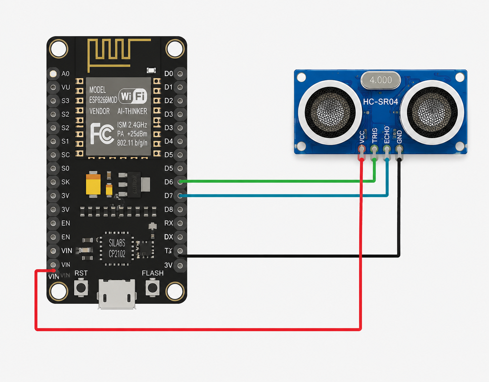
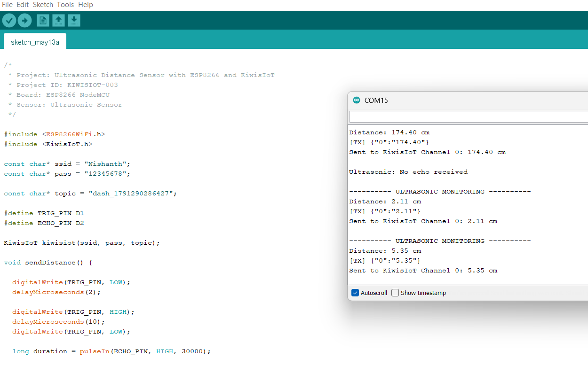
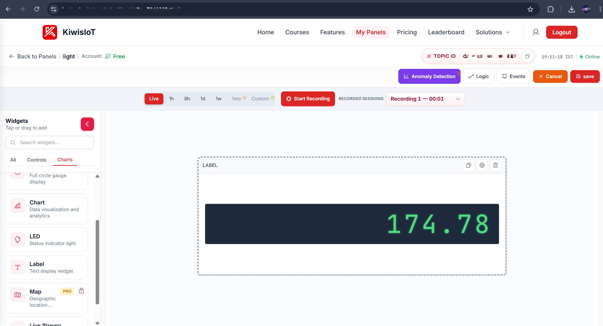

# Opstracle Detection with KiwisIoT

**Project ID:** KIWISIOT-003
**Board:** ESP8266 NodeMCU
**Sensor:** Ultrasonic Distance Sensor (HC-SR04)
**Platform:** Arduino IDE + KiwisIoT IoT Dashboard

An ESP8266-based monitoring system that measures distance with an ultrasonic sensor, calculates the distance in centimeters, and sends the reading over Wi-Fi to a KiwisIoT dashboard, where it is displayed live.

---

## Features

- Distance measurement in centimeters using an ultrasonic sensor
- Wi-Fi connectivity through the ESP8266 NodeMCU
- Live distance display on the KiwisIoT dashboard
- Readings sent every 2 seconds
- Serial Monitor output for local debugging

---

## Hardware Required

| Component | Quantity | Notes |
|-----------|----------|-------|
| ESP8266 NodeMCU (CP2102 or CH340 board) | 1 | Wi-Fi microcontroller |
| Ultrasonic Sensor (HC-SR04) | 1 | Trigger and Echo pins |
| Micro USB cable | 1 | Programming and power |
| Jumper wires | 4 | Female-to-female or as needed |
| Computer with Arduino IDE | 1 | Arduino IDE 1.8.19 or later |

---

## Circuit Diagram



## Wiring

| Ultrasonic Sensor Pin | ESP8266 NodeMCU Pin | Notes |
|-----------------------|---------------------|-------|
| VCC | VIN (5V) | HC-SR04 requires 5V |
| GND | GND | Common ground |
| TRIG | D6 (GPIO12) | Trigger output from ESP8266 |
| ECHO | D7 (GPIO13) | Echo input to ESP8266 |

> **Important:** The HC-SR04 ECHO pin outputs 5V, but the ESP8266 GPIO pins tolerate only 3.3V. Use a voltage divider (for example, 1 kΩ in series with the ECHO pin and 2 kΩ from the ECHO pin to GND) or a logic level shifter before connecting ECHO to D7.

---

## Setup Instructions

### 1. Install the ESP8266 Board Package

1. Open **File → Preferences**.
2. Add this URL to *Additional Boards Manager URLs*:
   ```
   http://arduino.esp8266.com/stable/package_esp8266com_index.json
   ```
3. Open **Tools → Board → Boards Manager**, search for `esp8266`, and install it.
4. Select **Tools → Board → NodeMCU 1.0 (ESP-12E Module)**.

### 2. Install the KiwisIoT Library

Install the `KiwisIoT` library so that `#include <KiwisIoT.h>` resolves.

### 3. Create a Dashboard on KiwisIoT

1. Log in at [kiwisiot.com](https://kiwisiot.com).
2. Go to **My Panels** and create a new panel named **Opstracle Detection with KiwisIoT**.
3. Add a **Label** widget to display the distance.
4. Copy your **Topic ID** (for example, `dash_XXXXXXXXXXXXX`).

### 4. Configure the Sketch

Edit these lines in `src/sketch_Opstracle_Detection.ino`:

```cpp
const char* ssid  = "YOUR_WIFI_SSID";
const char* pass  = "YOUR_WIFI_PASSWORD";
const char* topic = "YOUR_KIWISIOT_TOPIC_ID";
```

### 5. Upload the Code

1. Connect the NodeMCU to your computer over USB.
2. Select the correct COM port under **Tools → Port**.
3. Click **Upload**.

> **Important:** Close the Serial Monitor before uploading. If it stays open, the upload fails with `Access is denied` on the COM port.

### 6. Monitor the Output

1. Open **Tools → Serial Monitor**.
2. Set the baud rate to **115200**.
3. Move an object in front of the sensor and watch the distance change.

---

## How It Works

1. The ESP8266 connects to the configured Wi-Fi network and initializes KiwisIoT.
2. Every 2 seconds, the firmware sends a 10 µs pulse on TRIG to start a measurement.
3. It measures the time the ECHO pin stays HIGH with `pulseIn()` (30 ms timeout).
4. Distance is calculated as `duration × 0.0343 / 2` centimeters.
5. The distance is sent to KiwisIoT on Channel 0, and the Label widget updates.

### Core Code

```cpp
#include <ESP8266WiFi.h>
#include <KiwisIoT.h>

const char* ssid = "YOUR_WIFI_NAME";
const char* pass = "YOUR_WIFI_PASSWORD";

const char* topic = "YOUR_DASHBOARD_TOPIC_ID";

#define TRIG_PIN D6
#define ECHO_PIN D7

KiwisIoT kiwisiot(ssid, pass, topic);

void sendDistance() {

  digitalWrite(TRIG_PIN, LOW);
  delayMicroseconds(2);

  digitalWrite(TRIG_PIN, HIGH);
  delayMicroseconds(10);
  digitalWrite(TRIG_PIN, LOW);

  long duration = pulseIn(ECHO_PIN, HIGH, 30000);

  if (duration == 0) {

    Serial.println();
    Serial.println("Ultrasonic: No echo received");

    return;
  }

  float distance = duration * 0.0343 / 2;

  Serial.println();
  Serial.println("---------- ULTRASONIC MONITORING ----------");

  Serial.print("Distance: ");
  Serial.print(distance, 2);
  Serial.println(" cm");

  String distanceData = String(distance, 2);

  kiwisiot.send("0", distanceData);

  Serial.print("Sent to KiwisIoT Channel 0: ");
  Serial.print(distanceData);
  Serial.println(" cm");
}

void setup() {

  Serial.begin(115200);
  Serial.println("   ULTRASONIC DISTANCE MONITOR   ");

  pinMode(TRIG_PIN, OUTPUT);
  pinMode(ECHO_PIN, INPUT);

  digitalWrite(TRIG_PIN, LOW);

  Serial.println("Ultrasonic sensor initialized");

  Serial.println("Connecting to KiwisIoT...");

  kiwisiot.begin();

  Serial.println("KiwisIoT initialized");
  Serial.println("Starting distance monitoring...");
}

void loop() {

  kiwisiot.run();

  static unsigned long lastSend = 0;

  if (millis() - lastSend >= 2000) {

    lastSend = millis();

    sendDistance();
  }

  delay(100);
}
```

---

## Sample Serial Output



```
---------- ULTRASONIC MONITORING ----------
Distance: 5.35 cm
[TX] {"0":"5.35"}
Sent to KiwisIoT Channel 0: 5.35 cm

Ultrasonic: No echo received
```

---

## KiwisIoT Dashboard



The Label widget shows the latest distance reading in centimeters. The panel status shows **Online** when the ESP8266 is connected and sending data.

---

## Troubleshooting

| Problem | Likely Cause | Fix |
|---------|--------------|-----|
| `Access is denied` on upload | Serial Monitor is open | Close Serial Monitor, then upload again |
| `could not open port COMx` | Wrong port or driver missing | Reselect the port; install the CP2102/CH340 driver |
| `Ultrasonic: No echo received` | Wiring error, or object out of range or too soft | Check TRIG/ECHO wiring and power; point the sensor at a flat, hard surface |
| Distance readings are unstable | Loose wires or sensor too close to walls | Secure connections; keep the sensor away from walls |
| Wi-Fi not connecting | Wrong SSID or password, or 5 GHz network | Use a 2.4 GHz network and recheck credentials |
| Dashboard not updating | Wrong topic ID or no internet | Verify the topic ID and the Wi-Fi connection |

---

## Project Structure

```
Opstracle-Detection-KiwisIoT/
├── README.md
├── LICENSE
├── src/
│   └── sketch_Opstracle_Detection.ino
├── images/
│   ├── circuit_diagram.png
│   ├── serial_monitor.png
│   └── kiwisiot_dashboard.png
└── docs/
    └── KiwisIoT_setup.md
```

---

## Future Improvements

- Trigger an alert when the distance falls below a set threshold
- Log distance history for the KiwisIoT charts widget
- Add multiple ultrasonic sensors on different channels

---

## Acknowledgements

- [KiwisIoT](https://kiwisiot.com) for the IoT dashboard platform
- ESP8266 Community for the Arduino core

---

## License

This project is licensed under the MIT License. See the `LICENSE` file for details.
